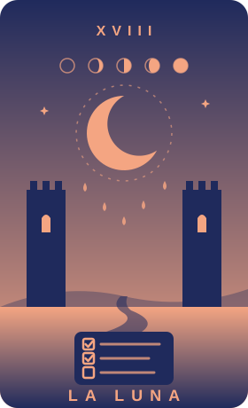

# XVIII · La Luna

Checks de las **actividades de cada día** para el celular (Android). Además de las actividades sueltas, tiene **tipos de día** (Viaje, Trabajo, Gimnasio…): plantillas con sus actividades, incluso las de **días antes o después**, que se asignan a días concretos o con **repetición** («Trabajo: L a V», «Viaje: cada 15 días»). Esos días se llenan solos, y La Luna **avisa** si algo se cruza.

La Luna rige los ciclos: lo que vuelve cada semana o cada quince días, y lo que hay que preparar antes y recoger después.

## Qué hace (versión 0.1)

- **Día**: la lista de checks del día, primero lo de «todo el día» y luego por hora. Marca hecho / no hecho y ve el progreso («3 de 5 hechas»). Tira de la **semana** arriba (puntos con el color de cada tipo, ⚠ si hay choques, ✓ si el día está completo), flechas para moverte y toque en la fecha para saltar a cualquier día.
- **Actividades sueltas** para un día: **todo el día**, **a una hora** o **de … a …**, con nota. Se editan o borran tocándolas.
- **Tipos de día** (pestaña «Tipos de día»): nombre, color y sus actividades, cada una con **cuándo**: *N días antes*, *el mismo día* o *N días después* del día marcado, y su horario. Ejemplo «Viaje»: *Empacar a, b* 1 día antes 20:00–21:00, *Revisar a, c* el mismo día 06:30, *Deshacer maleta* 1 día después.
- **Qué días**: repeticiones **cada N días** desde una fecha (con fecha final opcional) o **días de la semana** (con rango opcional), **días sueltos** y **excepciones**. Desde el día: «+ Marcar día como…» y quitar un tipo de ese día (si venía de una repetición queda como excepción).
- **Varios tipos en un día** (viaje + trabajo): se juntan sus actividades.
- **Tramos**: días seguidos del mismo tipo (un viaje del 28 al 30) son un solo tramo: lo de «antes» va antes del primer día y lo de «después» después del último. Se puede apagar por tipo.
- **Quitar solo este día** una actividad que viene de un tipo (y devolverla).
- **Avisos de conflicto**, en el día y en la pestaña **Revisar** (semana pasada a 60 días adelante, con «Visto» para que no vuelvan a salir):
  - ⚠ **Se cruzan las horas**: dos actividades del mismo día con horarios que se solapan (sueltas o de tipos).
  - • **Cae en otro día marcado**: una actividad de antes/después cae en un día de otro tipo (el «Deshacer maleta» del viaje cae en un día de Trabajo) o en otro tramo del mismo tipo (dos viajes muy seguidos).
  - • **Actividad cerca de un día marcado**: tienes una actividad suelta en los días de antes/después de un tipo (una cita médica el día antes del viaje).
- **Avisos** (opcionales, ⋮ → Avisos): notificación antes de cada actividad con hora (a la hora, 5, 10, 15, 30 o 60 min antes) y **resumen del día** por la mañana con los choques. Las hechas no avisan.
- **Respaldo**: ⋮ → Exportar respaldo (archivo JSON para guardar o enviar) e Importar respaldo (o compartir/abrir el `.json` con La Luna). Formato en `nucleo/Formato.kt`.

## Cómo usarla

1. En **Tipos de día** → «+ Tipo de día»: «Trabajo», actividades *Jornada* 08:00–17:00, repetición «Días de la semana: L a V».
2. Otro tipo «Viaje» con *Empacar* (1 día antes), *Revisar documentos* (el mismo día) y *Deshacer maleta* (1 día después), repetición «Cada 15 días» desde el primer viaje.
3. En **Día** verás las actividades cargadas solas; agrega las sueltas con «+ Actividad».
4. Revisa la pestaña **Revisar** de vez en cuando (el número rojo dice cuántos avisos hay).

## Privacidad

- Sin internet ni cuentas: todo queda en la memoria privada de la app (`luna.json`), sin copia en la nube (`allowBackup=false`). Exporta el respaldo JSON para guardarlo.
- Permisos: **notificaciones** (solo si activas los avisos) y **arranque** (para volver a programar el siguiente aviso al prender el celular). Usa alarmas normales, sin el permiso de alarmas exactas, así que un aviso puede llegar unos minutos tarde si el celular está en reposo.
- Registro de errores: mantén presionado el ícono → «Enviar registro» (no incluye tus actividades, solo eventos de la app).

## Cómo está hecho

- Kotlin + Jetpack Compose (Material 3), minSdk 26, compileSdk 37. Mismo esqueleto que El Emperador y La Emperatriz (AGP 9.4.0, Kotlin 2.4.10, Gradle 9.6.0).
- `nucleo/` es Kotlin puro (sin Android) con pruebas JUnit:
  - `Modelos.kt`: `Franja` (todo el día / hora / segmento), `Suelta`, `Plantilla` (con desplazamiento en días), `Repeticion` (cada N días, semanal), `TipoDia`, `Datos`, `Instancia`.
  - `Agenda.kt`: genera las actividades de cada día (las de los tipos no se guardan: se calculan; se guarda el «hecho» por instancia con la clave `t:<tipo>:<actividad>:<día marcado>`), tramos, marcar/quitar días, omitir.
  - `Conflictos.kt`: choques de horario, cruces de antes/después con otros días marcados y actividades cerca de un día marcado.
  - `Recordatorios.kt`: qué notificar y cuándo. `Formato.kt`: JSON del archivo y del respaldo (con `Json.kt` propio). `Textos.kt`: fechas y horas en español.
- `datos/` (archivo y ajustes), `avisos/` (AlarmManager + notificaciones), `ui/` (Compose), `registro/` (registro compartido de los Arcanos).

Pruebas del núcleo: `./gradlew test`.

## Instalar

**Sin el PC**: cada cambio en `main` se compila en GitHub Actions y el APK queda en [releases/ultima](https://github.com/el-ermitanho/la-luna-android/releases/tag/ultima) → descarga [`la-luna.apk`](https://github.com/el-ermitanho/la-luna-android/releases/download/ultima/la-luna.apk) en el celular e instálalo.

**Con el PC**: `C:\Git\compilar-todo.bat`, o abre la carpeta en **Android Studio** y pulsa **Run** con el celular conectado.

La llave de firma de prueba es la compartida de los Arcanos (`firma/`), así el APK del PC y uno compilado en GitHub se pueden instalar uno encima del otro.

Parte del mazo de [el-ermitanho](https://github.com/el-ermitanho).
